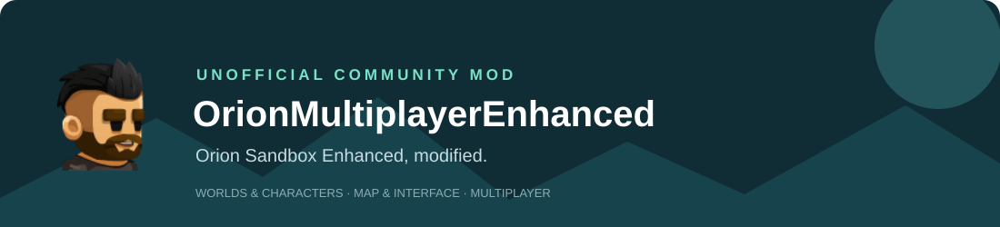

<strong>Orion Sandbox Enhanced, with all our changes.</strong> An unofficial modified edition: single-player and multiplayer worlds, characters, maps, interface improvements, and fixes.

<a href="README.ru.md">Русский</a> · <a href="https://github.com/Talleus/OrionMultiplayerEnhanced/releases">Downloads</a> · <a href="docs/INSTALL.md">Installation</a> · <a href="docs/COMMANDS.md">Commands</a> · <a href="docs/BUILD.md">Build</a>

## Download and install

1. Back up any existing Orion saves.
2. Download `OrionMultiplayerEnhanced-0.5.0-preview.1-Setup.exe` from [Releases](https://github.com/Talleus/OrionMultiplayerEnhanced/releases).
3. Run setup and choose a **new installation folder**.
4. Start **OrionMultiplayerEnhanced** from its desktop or Start menu shortcut.

The offline installer contains the complete working modified edition and its AIR runtime. It verifies and installs the bundled files, creates shortcuts, and includes an uninstaller. It does not ask for an original-game folder or download game files. Administrator rights, Java, Python, and FFDec are **not** required to use setup.

**Requirements:** Windows 10/11 x64 and about 500 MB free including temporary files. The setup executable is unsigned: verify its checksum before running it. See [installation, save backups, and removal](docs/INSTALL.md).

## Features

- Single-player and multiplayer world flows, world selection, and save integration.
- Character selection and player profile improvements.
- Direct-IP / LAN multiplayer, host lobby, player list, and world selection.
- Lobby and in-game chat, a chat bubble button, and typing indicators.
- Host-controlled return from a world to the same lobby room.
- Server-authorized operators and Minecraft-inspired commands.
- PvP controls and synchronized multiplayer interactions.
- Fullscreen map controls, hover labels, facing-aware portrait markers, and X-Ray commands.
- Green Back buttons inside network/world panels; **Back is beside Connect** on the join panel.

The installer includes the complete current set of changes: all 8 new classes and all 47 modified original classes. Multiplayer is one part of this edition. This is a **preview**. Implemented features have different levels of runtime validation; see the [test matrix and limitations](docs/TESTING.md).

## Play together

1. Everyone installs the **same mod release**.
2. The host opens **Multiplayer → Host**, selects a world, and shares a reachable IP and port.
3. Other players choose **Join lobby**, enter the host IP and TCP port `27015`, and connect.
4. The host starts the world. Type `/help` in chat.

Use trusted LAN/private-VPN peers during preview testing. This is not a hardened public server. See [networking](docs/NETWORKING.md).

## Operators

The host grants/revokes roles with `/op <player>` and `/deop <player>`. Operators can use most gameplay commands. They cannot grant roles, use host-only inventory editing, or kick/ban/kill/teleport the host. Roles expire on disconnect. See [commands](docs/COMMANDS.md).

## Source and builds

Included: **all 8 new AS3 classes and patches for all 47 changed original classes**, covering application, world, inventory, and UI integration. Original source exports and assets remain local to the owner's game. Source patches have verified before/after hashes.

| Directory | Contents |
| --- | --- |
| `src/` | Complete new mod classes |
| `patches/` | Integration changes against a verified original FFDec export |
| `payload/` | Verified binary delta for developer reconstruction |
| `modkit/`, `installer/`, `tools/` | Patcher, setup/uninstaller, build tools, test bot |
| `tests/` | Corruption, wrong-version, ownership, patch, and uninstall checks |

[Build instructions](docs/BUILD.md) explain reference reconstruction and original-dependent source materialization/recompilation. This is a mod of a closed-source game, not a build of its entire engine from open sources.

## License and credits

Our modification code and tools use the [MIT license](LICENSE). The modified game installer also contains original game code, graphics, sound, and runtime components; these retain their respective ownership and are outside MIT. The repository contains new classes and integration patches, not an open-source license for the original game engine. See [third-party notices](THIRD_PARTY_NOTICES.md).

**Unofficial community mod. Not affiliated with or endorsed by the original developers, publisher, or Steam.** Rights to Orion Sandbox Enhanced remain with their respective owners.
