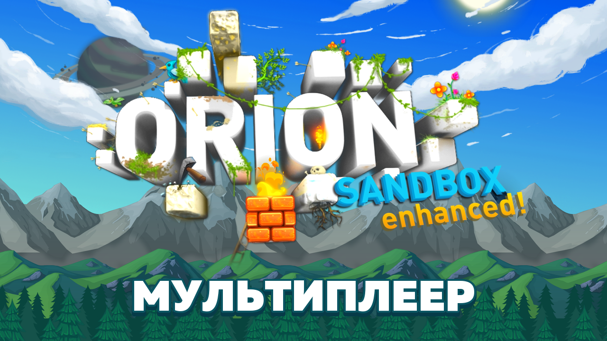

<strong>Orion Sandbox Enhanced со всеми нашими изменениями.</strong> Неофициальная модифицированная версия: одиночные и сетевые миры, персонажи, карта, доработки интерфейса и исправления.

<a href="README.md">English</a> · <a href="https://github.com/Talleus/OrionMultiplayerEnhanced/releases/download/v1.0/OrionMultiplayerEnhanced-1.0-Setup.exe">Скачать .exe</a> · <a href="docs/INSTALL.md">Установка</a> · <a href="docs/COMMANDS.md">Команды</a> · <a href="docs/BUILD.md">Сборка</a> · <a href="https://github.com/Talleus/OrionMultiplayerEnhanced/issues">Обратная связь</a>

 <strong>1.0 · Windows 10/11 x64</strong> <a href="https://github.com/Talleus/OrionMultiplayerEnhanced/releases/tag/v1.0">Описание релиза</a> · <a href="https://github.com/Talleus/OrionMultiplayerEnhanced/releases/download/v1.0/SHA256SUMS.txt">SHA-256</a>

## Разработка и обратная связь

**Проект ещё в активной разработке.** Мы продолжаем дорабатывать игру, сетевые функции, интерфейс и установщик. В версии 1.0 возможны ошибки и незавершённые функции.

Если что-то не работает, есть вопрос или идея — обращайтесь через [GitHub Issues](https://github.com/Talleus/OrionMultiplayerEnhanced/issues). Там же обсуждаем проблемы и предложения; личную почту оставлять не нужно. По возможности укажите версию сборки, шаги воспроизведения и приложите скриншот.

## Скачать и установить

1. Сделайте резервную копию существующих сохранений Orion.
2. [Скачайте установщик для Windows (.exe)](https://github.com/Talleus/OrionMultiplayerEnhanced/releases/download/v1.0/OrionMultiplayerEnhanced-1.0-Setup.exe).
3. Запустите мастер и выберите **папку установки**.
4. Открывайте **OrionMultiplayerEnhanced** через ярлык на рабочем столе или в меню «Пуск».

Установщик содержит нашу рабочую модифицированную версию целиком, вместе с игровыми файлами и AIR. Он работает офлайн, проверяет целостность файлов, создаёт ярлыки и средство удаления. Указывать папку исходной игры не требуется. Права администратора, Python, Java и FFDec для установки **не нужны**. [Подробная инструкция](docs/INSTALL.md).

**Требования:** Windows 10/11 x64 и около 500 МБ свободного места с учётом временных файлов. Установщик не подписан: сверяйте SHA-256.

## Возможности

- Одиночные и сетевые миры, выбор миров и интеграция сохранений.
- Доработки выбора персонажей и профилей игроков.
- Подключение по IP/LAN, комната лобби, список игроков и выбор миров.
- Чат в комнате и в игре, кнопка-облачко и индикатор «печатает…».
- Возврат в ту же комнату после остановки мира хостом.
- Операторы и команды с проверкой полномочий на стороне хоста.
- Управление PvP и синхронизация игровых действий.
- Полноэкранная карта, подписи блоков, портреты по направлению движения и X-Ray.
- Зелёные кнопки «Назад» на сетевых панелях и странице миров; в подключении **«Назад» справа от «Подключиться»**.

Установщик включает весь текущий набор изменений: все 8 новых классов и все 47 изменённых классов оригинала. Сетевая игра — одна из частей этой версии. Версия **1.0** остаётся в активной разработке. Реализация функции не означает её проверку во всех сетевых сценариях: см. [проверки и ограничения](docs/TESTING.md).

## Как играть вместе

1. У всех должна быть **одинаковая версия мода**.
2. Хост открывает «Сетевая», создаёт комнату и выбирает мир.
3. Остальные открывают «Присоединиться к лобби», вводят доступный IP хоста и TCP-порт `27015`.
4. Хост запускает мир. Справка в чате: `/help`.

Для сетевой игры используйте доверенных игроков в LAN или частной VPN. Мод пока не рассчитан на открытые серверы с недоверенными клиентами. [Подробнее о сети](docs/NETWORKING.md).

## Операторы

Хост выдаёт права через `/op <игрок>`, снимает — через `/deop <игрок>`. Оператору доступны почти все игровые команды. Выдача прав и прямое редактирование инвентаря остаются у хоста. Оператор не может кикнуть, забанить, убить или телепортировать хоста. Права сбрасываются при отключении. [Все команды](docs/COMMANDS.md).

## Исходный код

Включены **все 8 новых AS3-классов и патчи всех 47 изменённых классов оригинала**: приложение, мир, инвентарь и интерфейс. Полный декомпилированный оригинал и ресурсы остаются локально у владельца игры. [Сборка](docs/BUILD.md).

Собственный код модификации, установщика и инструментов — по [MIT](LICENSE). В установщике также находятся исходные игровые компоненты и ресурсы: права на них остаются у соответствующих правообладателей и под MIT не передаются. Репозиторий открывает наш код и патчи; это не открытие исходного движка оригинальной игры. [Уведомления](THIRD_PARTY_NOTICES.md).

**Неофициальный мод сообщества. Не связан с авторами и издателем оригинальной игры и не одобрен ими или Steam.** Права на Orion Sandbox Enhanced сохраняются за соответствующими правообладателями.
